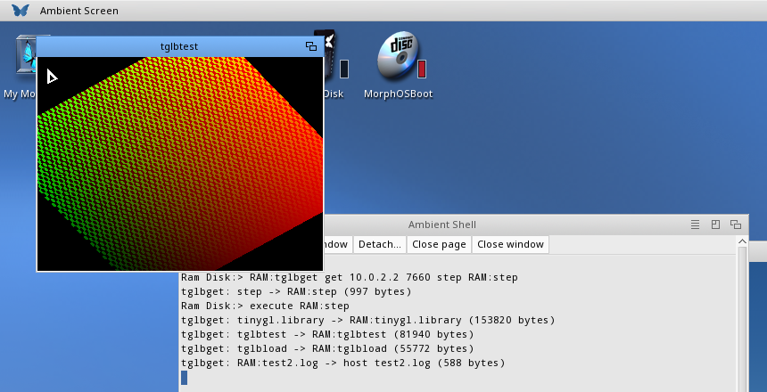
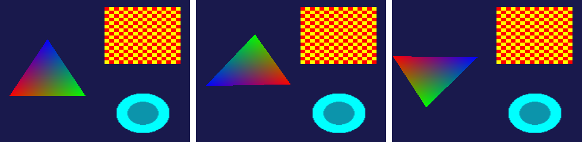

# morphos-3d-emu

Hardware-accelerated 3D for **MorphOS guests running in QEMU (pegasos2) on Windows**.

QEMU's emulated `ati-vga` has no 3D engine, and MorphOS TinyGL has no software fallback, so TinyGL programs
cannot render in an emulated MorphOS at all. This project fixes that **without modifying QEMU**:

- **TGLBridge** is a drop-in replacement `tinygl.library` for MorphOS. It forwards every TinyGL/OpenGL call
  over TCP (QEMU user networking) to the Windows host.
- **tglhost.exe** runs on Windows and executes those calls with the PC's real OpenGL driver.

Unmodified TinyGL programs, built against the stock MorphOS SDK headers, render through it.



## Download

Get the latest release from <https://github.com/angree/morphos-3d-emu/releases>:

- `morphos-3d-emu-<date>.zip` (about 42 MB): ready to run on Windows. Contains `tglhost.exe`, the MorphOS guest
  binaries (`tinygl.library`, `tglbload`, `tglbget`, `tglbtest`), the lab scripts and a trimmed, **unmodified**
  QEMU 11.1.0 for Windows (`qemu-system-ppc.exe`, the DLLs it loads, and the pegasos2 firmware files it opens),
  with every licence text in `LICENSES\`.
- `morphos-3d-emu-sources-<date>.zip` (about 0.9 GB): the complete corresponding source of everything third-party
  in the binary zip (QEMU tree of the exact build, the official QEMU 11.1.0 tarball, MSYS2 source packages,
  gcc 13.1.0 for `libssp-0.dll`), with `SHA256SUMS.txt`. You only need it if you want the sources.

The only thing you have to get yourself is the MorphOS 3.20 ISO.

## Requirements

- Windows 10 or 11 (x64) with an OpenGL driver that supports framebuffer objects (OpenGL 3.0 or GL_ARB_framebuffer_object; any current NVIDIA, AMD or Intel driver).
- **QEMU for Windows** with the `pegasos2` machine. The release zip contains a trimmed, unmodified copy of
  QEMU 11.1.0 (see [Licences](#licences)); any installed QEMU 9.x or newer for Windows should also work.
- **MorphOS 3.20 ISO**, downloaded by you from <https://www.morphos-team.net/>. It is not included and never
  will be. Unregistered MorphOS runs fully but slows down after 30 minutes; that is MorphOS behaviour.
- **WSL** (or any Linux) with `xorriso`, once, to make the lab copy of the ISO (`wsl sudo apt install xorriso`).
- PowerShell 5.1 (built into Windows). Python is **not** needed to run the lab.

## Quick start

1. **Unpack** the release zip (`morphos-3d-emu-<date>.zip`) anywhere, e.g. `C:\morphos-3d-emu`.
2. **Put your MorphOS ISO** at `morphos\morphos-3.20.iso` inside that folder (or set `MorphOSIso` in `config.ps1`,
   the only file you may need to edit).
3. **Make the lab ISO** (your original ISO stays untouched):
   `powershell -ExecutionPolicy Bypass -File tools\remaster.ps1`
4. **Start everything:** `powershell -ExecutionPolicy Bypass -File lab\run.ps1`
   - a QEMU window opens with MorphOS; click **OK** in the boot language window;
   - about 30 s after the desktop appears, the guest brings its network up, loads the bridge and runs the
     `tglbtest` demo. The 3D output appears in the **tglhost** window on Windows and, mirrored, in the
     MorphOS window. Logs from the guest arrive in `inbox\`.
5. **Run your own program:** put it in `lab\serve\` and edit `lab\serve\step` (an AmigaDOS script the guest
   fetches and executes at boot), or open a Shell in MorphOS and type
   `RAM:tglbload RAM:tinygl.library` once, then start any TinyGL program.
   Stop with `powershell -ExecutionPolicy Bypass -File lab\stop.ps1`.

`lab\run.ps1 -Hidden` does the same with no windows at all (QEMU `-display none`, tglhost off-screen); the
language window is then confirmed through the QEMU monitor. `lab\start-qemu.ps1 -DryRun` prints the exact
QEMU command line.

## How it works

```
MorphOS guest (QEMU pegasos2)                                Windows host
+----------------------------+   TCP 10.0.2.2:7654    +-----------------------------------+
| TinyGL program (stock SDK) |   (QEMU user net,      | tglhost.exe (C, Win32 + WGL)      |
|  glXxx() -> TinyGLBase LVO |    rtl8139 -> eth1)    |  one connection = one GL context  |
| tinygl.library (TGLBridge) | ---------------------> |  decode -> real opengl32 calls    |
|  752 slots, batched stream | <--------------------- |  FBO = guest window size          |
|  256 KB buffer per context |  replies: gets, swap,  |  blit to host window (no focus)   |
+----------------------------+  readback, mirror      |  BMP shots, fps log               |
                                                      +-----------------------------------+
        ide0: (FAT)  <-- lab\xfer     tglbget <-- TCP 7660 --> lab\tglbserve.ps1 (lab\serve, bin\guest)
```

- **Channel:** plain TCP over QEMU user networking. The guest connects to `10.0.2.2:7654`, which QEMU maps to
  the host's `127.0.0.1:7654`. Everything listens on loopback only. One socket per GL context; `TCP_NODELAY` on.
- **Wire protocol** (`bridge/common/tglb_proto.h`): `u32 opcode, u32 length, payload`, big-endian. Opcodes below
  0x1000 are the library slot number (LVO/6), so guest and host share one table; 0xF000+ are protocol messages
  (HELLO, CREATE, SWAP, ARRAY, UNIMPL, ...). The guest batches commands and flushes when the buffer is full, on
  `glFlush`, and on every call that returns something (`glGet*`, `glReadPixels`, swap, ...).
- **Guest library:** a real MorphOS system library (ROMTag, `MakeLibrary` function array). The 752 slots are
  generated by `bridge/gen/gen.py` from the SDK's own `ppcinline/tinygl.h`: 338 scalar calls are serialised
  automatically, 149 fixed-size vector calls and 17 pname-dependent vector calls are generated too, 49 are
  hand-written (contexts, swap, client vertex arrays with `glLockArraysEXT`, textures, pixel transfer, gets),
  and 192 unimplemented ones report themselves once to the host log. `tglbload` replaces the in-memory system
  `tinygl.library` with the bridge; the file in `MOSSYS:Libs` stays untouched and a reboot restores it.
- **Host:** `tglhost.exe` (MSVC, Win32 + WGL, no other dependencies) gives each connection a hidden window and
  an FBO the size of the guest window. On swap it blits to its window (which never takes focus) and can send
  the frame back ("mirror") so it also appears inside the MorphOS window.
- **Lab:** `tools/remaster.sh` makes a lab copy of your ISO: it moves the PEGASOS audio driver out of the boot
  path (on QEMU pegasos2, audio starting before the PCI network driver breaks networking) and appends a
  four-line hook to `S/user-startup` that runs `ide0:tglb-autorun` from the transfer disk.

Guest settings (ENV variables, read at `GLInit`): `TGLBRIDGE_HOST` / `TGLBRIDGE_PORT` (default `10.0.2.2` /
`7654`), `TGLBRIDGE_MIRROR` (copy every Nth frame back into the guest window; 0 = off), `TGLBRIDGE_LOG` (guest
log file; use `RAM:`, never the FAT transfer disk), `TGLBRIDGE_TRACE` (1 = trace to the serial log).

Measured in the lab (QEMU pegasos2, MorphOS 3.20, RTX 3060 Ti): the basic demo runs at about 18 fps with
mirroring on; the stress test (10,000 textured, vertex-coloured triangles per frame, about 180 KB of vertex
data per frame) reaches 7.0 fps without mirroring and 4.6 fps with it. The limit is the emulated network link
(about 1.2–1.3 MB/s); the host GPU is idle. These numbers say nothing about real MorphOS hardware.



## Limitations

- **A reference GL, not a TinyGL emulator.** The host renders spec-correct desktop OpenGL; quirks of the real
  TinyGL/Radeon drivers do not appear. `GL_MAX_TEXTURE_SIZE` and texture unit counts are the host's.
- **Bandwidth:** client vertex arrays are re-sent on every draw (deduplicated only within one
  `glLockArraysEXT`), so big static meshes cost link bandwidth every frame.
- **Not implemented** (logged once on the host, return 0/NULL): GLUT, VBOs and GLSL, selection/feedback,
  evaluators, `glCallLists`, `glInterleavedArrays`, paletted/compressed/3D textures, `glGetTexImage` and most
  `glGet{TexParameter,Light,Material}*`, `glBitmap`, `glPolygonStipple`, `GLAInitializeContextBitMap`,
  `GLASetAttr`; `TGLGetProcAddress` returns NULL. `glGet*` with an unknown multi-value pname returns one value.
- Screen contexts (`GLAInitializeContextScreen`) are implemented but only the window path is tested.
- The host window is display-only; input stays in the MorphOS window.
- The lab needs one click per boot (the MorphOS language window), and the network setup is repeated on every
  boot because the live CD keeps no interface definition.
- Windows only on the host side (WGL). The protocol itself is platform-neutral.

## Building from source

See [docs/BUILD.md](docs/BUILD.md): the guest side needs the
[morphos-cross](https://github.com/metaneutrons/morphos-cross) toolchain and the MorphOS SDK (installed by
you); the host side needs MSVC 2022. The SDK-derived `gen_*` files are generated at build time and are not
part of this repository. Tests: `tests/fakeguest.py` drives `tglhost.exe` without QEMU; `tests/tglbtest.c` is
the guest demo/test program.

## Repository layout

| path | what |
|---|---|
| `bridge/guest/` | `tinygl.library` (TGLBridge), `tglbload` (installs it), `tglbget` (file transfer), `build.sh` |
| `bridge/host/` | `tglhost.exe` sources, `build.bat`, `tglbserve.py` (Python version of the file server) |
| `bridge/common/` | wire protocol shared by both sides |
| `bridge/gen/gen.py` | generates the slot tables from the installed SDK header |
| `tests/` | `tglbtest.c` (guest), `fakeguest.py` (host self-test) |
| `config.ps1` | the one config file: QEMU folder, MorphOS ISO, transfer folder, ports |
| `lab/` | PowerShell lab scripts, guest boot scripts (`xfer/`), the default guest step script (`serve/step`) |
| `tools/` | `remaster.sh` / `remaster.ps1` and the `user-startup` hook |

## Credits

- [QEMU](https://www.qemu.org/) and its developers, including the pegasos2 emulation and its notes on MorphOS
  driver order by BALATON Zoltan.
- Windows builds of QEMU by Stefan Weil (<https://qemu.weilnetz.de/>); the release zip ships a subset of one.
- The [MSYS2](https://www.msys2.org/) project, whose mingw-w64 packages provide QEMU's DLLs.
- The MorphOS Team for MorphOS, TinyGL and the SDK.
- [metaneutrons/morphos-cross](https://github.com/metaneutrons/morphos-cross) for the cross toolchain.

## Licences

- Everything in this repository is under the **MIT licence** (`LICENSE`), copyright the morphos-3d-emu authors.
- **MorphOS** is (C) MorphOS Team. It is **not included**: you download the ISO yourself, and `tools/remaster.sh`
  only edits your local copy. No MorphOS SDK header or file is part of this project; the generated `gen_*` files
  are produced on your machine from your SDK. Our `tinygl.library` is an independent implementation of the
  TinyGL interface and contains no MorphOS Team code. "MorphOS" and "TinyGL" are names of their owners.
- **QEMU** is under GPL-2.0 (with parts under compatible licences). QEMU is a trademark of Fabrice Bellard;
  this project is not affiliated with or endorsed by the QEMU project. QEMU is not modified, and our programs
  talk to it only over a TCP socket.
- The **release zip** additionally contains an unmodified subset of the QEMU 11.1.0 Windows build and the DLLs it
  needs, each under its own licence. The zip carries every licence text in `LICENSES\` and a file-by-file table in
  `THIRD-PARTY.md`; the complete corresponding sources are published as a separate release asset
  (`morphos-3d-emu-sources-<date>`) next to the binaries (`SOURCES.md` in the zip explains it).
- `brlapi-0.8.dll` was built by the maintainer of the QEMU Windows builds, and its exact source version cannot be
  determined; the sources asset contains BRLTTY 6.2 (the version of that build) and `SOURCES.md` carries a written
  offer, valid for three years from the release date: open an issue titled "brlapi source request".
- `libdb-6.2.dll` (Berkeley DB, AGPL-3.0) is loaded indirectly by QEMU (through `libjack64.dll`); its full source
  is in the sources asset.
- What this repository uses but does not contain, and where to get it: [THIRD-PARTY.md](THIRD-PARTY.md).

## Strict mode ("real TinyGL" emulation, T73)

The bridge normally copies client vertex arrays and indices at the draw call and the host renders spec-correct desktop
GL. That hides a whole class of bugs that the real MorphOS TinyGL on a Radeon shows. `ENV:TGLBRIDGE_STRICT` (guest,
read at `GLInit`, decimal or `0x` hex) switches on emulations one by one; the host logs the mode per connection
(`client N: STRICT mode 0x..`).

| bit | name (`tglb_proto.h`) | what the bridge does |
|---|---|---|
| `0x01` | `STRICT_LAZY_ARRAYS` | a draw only records the array pointers; guest memory is read at the next flush point (buffer full, `glFlush`, `glFinish`, swap, any call that returns a value, full queue of 8192 draws). A buffer the program rewrites after the draw renders with the new contents, as with a driver that reads client memory late. |
| `0x02` | `STRICT_LAZY_INDICES` | the index array is read late too (implies `0x01`). Without it, indices are copied at the call. |
| `0x04` | `STRICT_STRIDE_TCCOL` | texcoord / colour / normal arrays with a non-tight stride are read as if tight. **Assumption**, not a documented TinyGL behaviour (see below). |
| `0x08` | `STRICT_STRIDE_XYZ` | the same for the vertex (position) array. Kept separate: the evidence says real TinyGL draws a strided position array correctly. |
| `0x10` | `STRICT_LIMITS` | host side: `GL_MAX_TEXTURE_SIZE` = `TGLBRIDGE_MAXTEX` (default 2048), `glTexImage2D` larger than that fails with `GL_INVALID_VALUE`; a texture memory budget `TGLBRIDGE_TEXMB` (default 96 MB, 16-bit formats counted as 2 bytes/texel) makes uploads beyond it fail; index type / indices-per-call statistics are logged. |
| `0x20` | `STRICT_CANARY` | checksums every enabled array (vertex range of the draw) and the indices at the draw call, and again at the flush point. A mismatch = the program changed memory a deferring driver may still read. Changes nothing on screen; works with or without `0x01`. Each changed buffer is logged once in `TGLBRIDGE_LOG`; every bad frame and every 100th frame send a line to the host log (`guest note: strict: CANARY BAD FRAME frame N bad_draws B draws D ...`). |
| `0x40` | `STRICT_LAG_SWAP` | the swap does not wait for the host: up to `TGLBRIDGE_LAG` frames (default 3) stay queued, so deferred draws are read up to that many frames after the call (a card running behind with `GLASetSync(0)`). Queries that do not depend on drawing (gets, `glGenTextures`, `glGetError`) are answered out of band ahead of the queued frames. Implies `0x01`. |

`TGLBRIDGE_LAZYMIN=N`: with `0x01`, draws that use fewer than N vertices are still read at the call (a driver that
copies small batches into its command buffer and DMAs only large ones; see the validation notes).

Host: `tglhost --shot-every N [--shot-from S]` saves every Nth frame of every client
(`clientN_frameNNNNN.bmp`), for frame-by-frame comparisons from a static camera.

`tglbtest reuse <secs> [tight]` draws 64 quads per frame from one CPU-side buffer that is rewritten between the draws
(the bug-B pattern): 64 coloured quads with strict 0, only the last quad with `0x01`, canary hits with `0x20`.

What is known and what is assumed:
- The MorphOS SDK (`tgl/*.h`, autodocs) documents none of these behaviours. Each emulation is the plausible failure,
  calibrated against the wow3d real-hardware reports; it is not a model of the R200 driver.
- Stride: wow3d 3309 drew its baked terrain (one interleaved 24-byte vertex: xyz, uv, rgba at stride 24) as spiky
  grey triangles on real TinyGL, while the original terrain (xyz stride 24, uv tight, no colours) was fine.

Validation (QEMU lab, wow3d MorphOS, static camera in Goldshire, 2026-11-13):
- Lazy reads + 3-frame lag (`0x61`): single-frame triangle shards from doodads on wow3d 3316 and 3318 (the real-Radeon
  bug B). Gone with the 3319 fix (4-frame copy ring, indices and tight arrays copied, canary 0), and back with the
  same binary set to the 3316 behaviour (`tgl_ring=2 tgl_idxcopy=0 tgl_copyall=0`).
- Side effect: the UI overlay (16 quads per atlas from one reused tight buffer) is drawn wrong under any lazy mode, a
  symptom real Radeons did not report. Real TinyGL probably copies small batches at the call; `TGLBRIDGE_LAZYMIN`
  models that but has not been validated yet.
- The stride emulation (bug A, wow3d 3309/3315) has not been validated against wow3d yet; it is only demonstrated with
  `tglbtest`.
